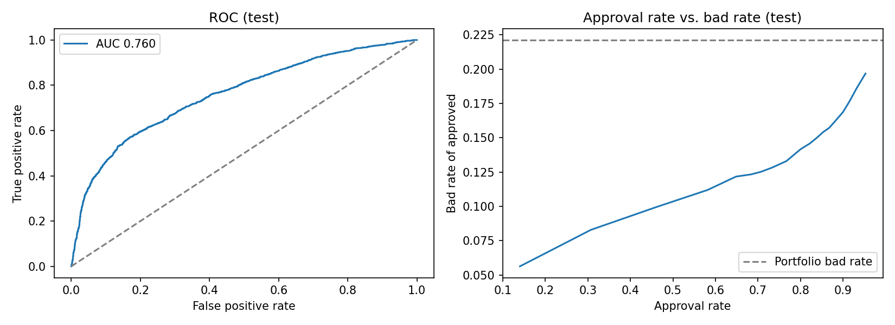

# Credit Card Default PD Scorecard

A points-based application/behavioral scorecard that predicts next-month default for 30,000 credit card accounts, built the way a bank credit-risk team would: WOE binning, IV-based feature selection, logistic regression, out-of-sample validation and a cutoff strategy.

**Data:** [UCI "Default of Credit Card Clients"](https://archive.ics.uci.edu/dataset/350/default+of+credit+card+clients) (Taiwan, 2005; 30,000 accounts, 22.1% default rate). Public dataset.

## Results (30% stratified hold-out)

| Metric | Value |
|---|---|
| AUC (train / test) | 0.770 / 0.760 |
| KS (test) | 0.401 |
| Gini (test) | 0.519 |
| PSI, score train vs. test | 0.001 (stable) |
| Bad rate of approved accounts at 80% approval | **14.2% vs. 22.1% portfolio (-36%)** |
| Defaults avoided at 80% approval | 48.8% |



## Method

1. **Feature engineering (10 features):** latest repayment status, max and count of delinquent months over 6 months, credit limit, latest and 6-month average utilization, latest and 6-month payment-to-bill ratio, bill-balance trend, education.
2. **Binning and WOE:** quantile bins (6) fitted on the training set only; WOE = ln(%good / %bad) with smoothing.
3. **Feature selection:** Information Value ≥ 0.02. Strongest predictors: repayment status (IV 0.89), months delinquent (0.87), max delinquency (0.82).
4. **Model:** logistic regression on WOE-transformed features.
5. **Scaling:** 600 points = 50:1 good:bad odds, PDO 20 (`outputs/scorecard_points.csv`).
6. **Strategy:** approval rate vs. bad rate at every score cutoff (`outputs/cutoff_analysis.csv`), plus score-decile bad rates for monitoring (`outputs/score_deciles.csv`).

**Fair lending:** SEX, MARRIAGE and AGE are excluded as model inputs.

## Run

```bash
python src/scorecard.py   # needs pandas, numpy, scikit-learn, matplotlib
```

Expects `data/credit_default.csv` (the UCI file converted to CSV with the header row removed).

## Limitations

- Single 2005 snapshot from one market, so no out-of-time validation; PSI is train vs. test only.
- No reject inference: the data contain approved accounts only.
- Bins are quantile-based, not monotonic-constrained; a production model would enforce monotonic WOE.
